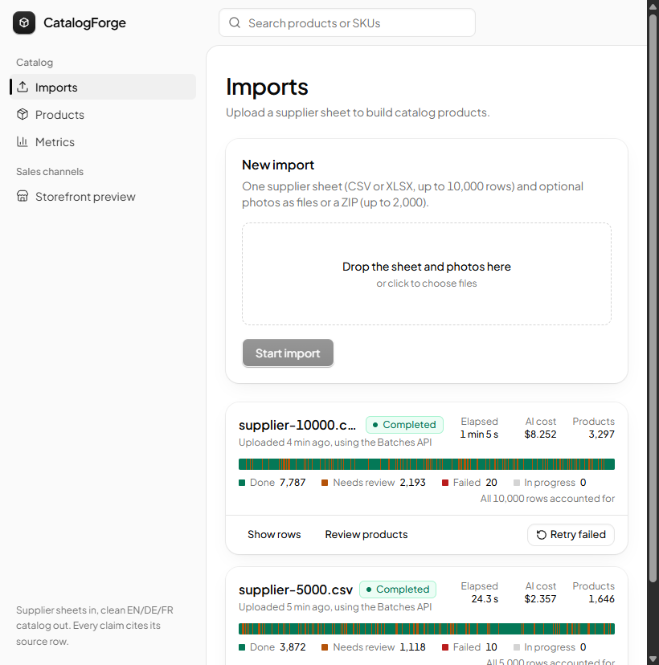
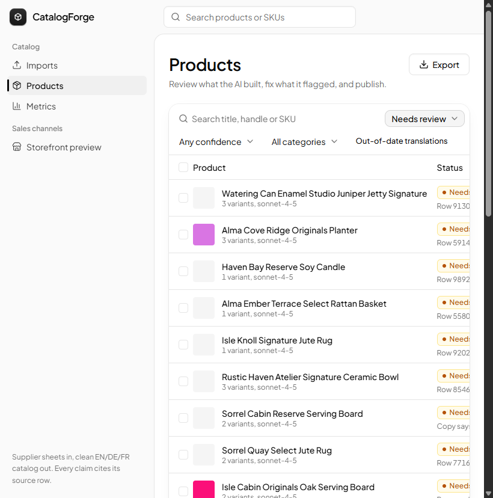
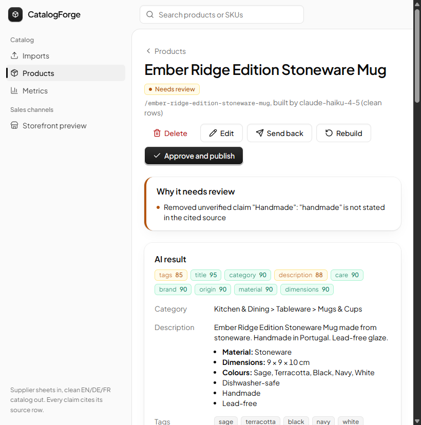
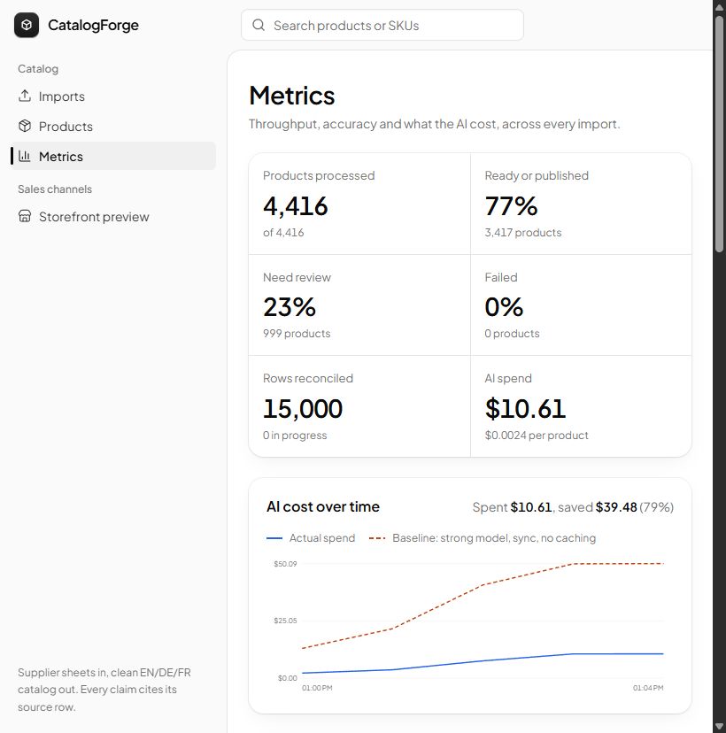
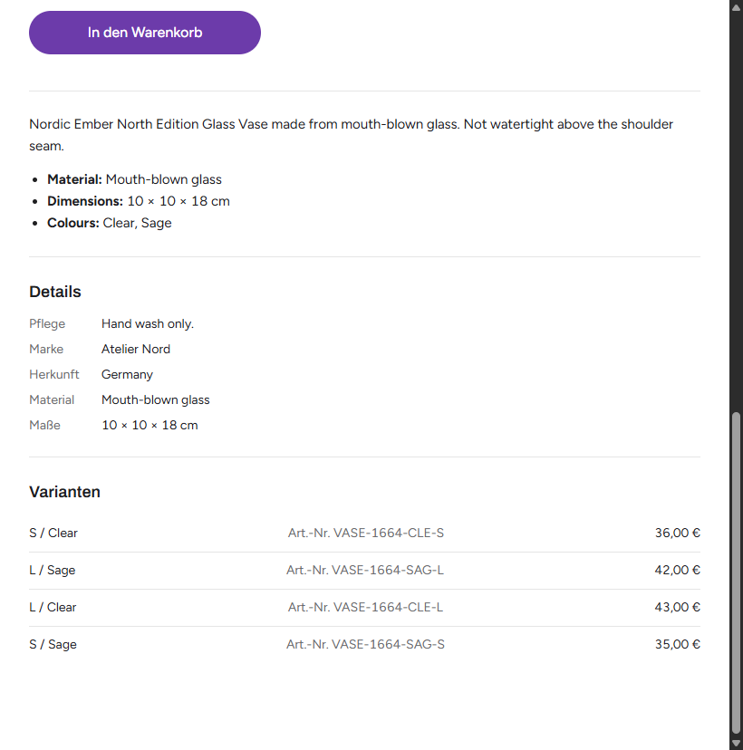
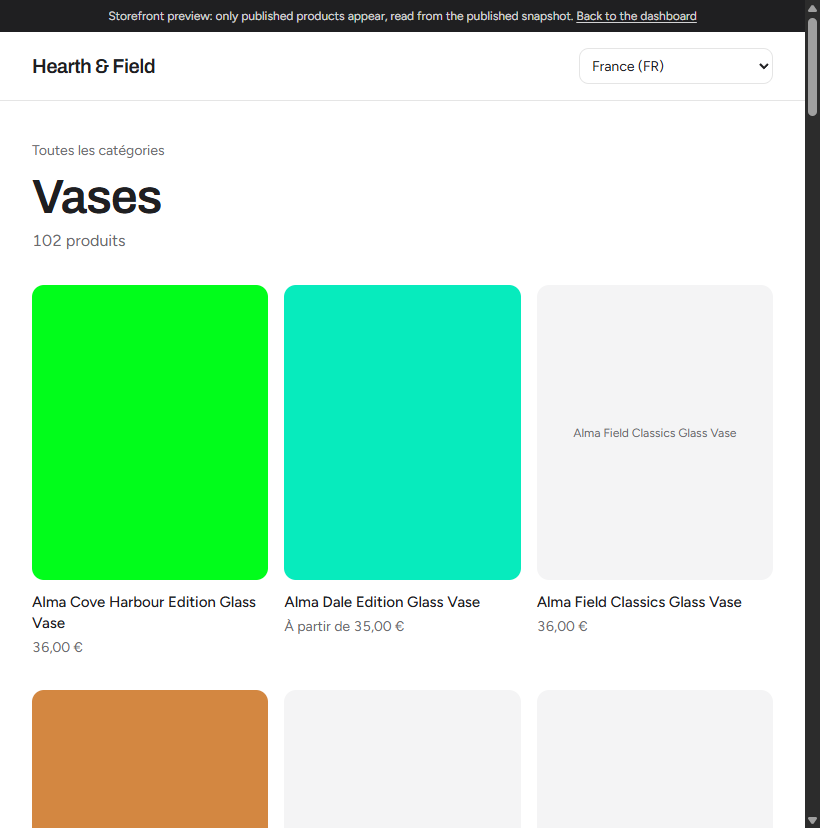
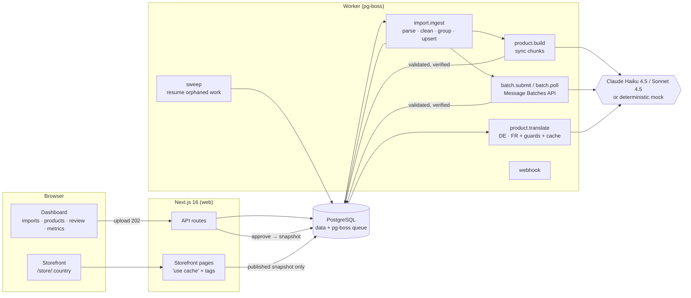

# CatalogForge

**Drop in a messy supplier sheet and a folder of photos; get a clean, store-ready catalog in English, German and French, reviewed, published to a storefront and exported.**

CatalogForge cleans supplier data before any AI sees it, asks the model only for what needs judgment, verifies every claim the model makes against the exact cell it cites, and runs every step in a durable queue that survives crashes, rate limits and 10,000-row sheets without slowing the storefront.

| Imports: live per-row status strip | Products: filters, confidence, bulk approve |
|---|---|
|  |  |
| **Review: why it needs review, claims and their sources** | **Metrics: cost vs baseline, routing, speed** |
|  |  |
| **Storefront, German (country DE)** | **Collection, French (country FR)** |
|  |  |

---

## Contents

- [Quick start](#quick-start)
- [Architecture](#architecture)
- [Measured results](#measured-results)
- [Scale strategy](#scale-strategy-queue-retries-restarts-duplicates)
- [Accuracy strategy](#accuracy-strategy)
- [Cost strategy](#cost-strategy)
- [Bonus features and public API](#bonus-features-and-public-api)
- [Tech stack and design decisions](#tech-stack-and-design-decisions)
- [Technical write-up](#technical-write-up)
- [Security](#security)
- [Limitations](#limitations)
- [Project layout](#project-layout)

---

## Quick start

Requirements: Docker, [Bun](https://bun.sh) 1.3+, Node 22+. Optional: [k6](https://k6.io) for the load test.

```bash
docker compose up -d          # Postgres 17 on localhost:5433 (+ a test database)
bun install
cp .env.example .env          # works as-is: AI_PROVIDER=mock needs no API key
bun run up                    # migrates, generates sample sheets, starts web + worker
```

Open **http://localhost:3000**. Sample sheets and photo ZIPs to upload are in [`samples/`](samples/) (200 rows and 10,000 rows); `bun run fixtures` regenerates them and a 5,000-row set in `fixtures/out/`.

**Using Claude instead of the mock:** set `AI_PROVIDER=anthropic` and `ANTHROPIC_API_KEY=…` in `.env` and restart. To go through [Vercel AI Gateway](https://vercel.com/docs/ai-gateway/sdks-and-apis/anthropic-messages-api) instead, set `AI_GATEWAY_API_KEY=…`; the same Anthropic SDK is pointed at the gateway and model ids are mapped (`claude-haiku-4-5` → `anthropic/claude-haiku-4.5`). Batches are split per model and capped at 1,000 requests (a gateway rule); if the gateway refuses batches for the key, those products are built with normal calls instead. `bun run real-run` (with `REAL_DATABASE_URL` pointing at a database it may wipe) imports the labelled 200-row sample with real models and scores it; it costs about $0.50.

**Production:** set `ADMIN_PASSWORD` (the server refuses to start the dashboard without it) and optionally `AI_DAILY_BUDGET_USD`. The browser asks for the password once (any user name). Models are configurable (`AI_MODEL_CHEAP=claude-haiku-4-5`, `AI_MODEL_STRONG=claude-sonnet-4-5`).

| Command | What it does |
|---|---|
| `bun run up` / `bun run up -- --prod` | Web + worker together (dev / production build with the 4-process server) |
| `bun run serve` | Production web server: Next.js in N processes (`WEB_CONCURRENCY`, default 4) |
| `bun run dev`, `bun run worker` | Run them separately |
| `bun run fixtures` | Regenerate the messy sample sheets and photo ZIPs |
| `bun run check` | Typecheck + lint + unit tests |
| `bun run test:integration` | Full imports against Postgres with the mock AI (crash, rate-limit, faults, batches, webhook) |
| `bun run eval` | Accuracy of the cleaner against a labelled 2 × 10,000-row test set |
| `bun run scale-run` | 5k seed import → publish → 10k import while k6 hammers the storefront → `load/results/` |

---

## Architecture



**Flow of one import**

1. **Upload** (`POST /api/imports`) validates type/size/counts, stores files and returns **202 in ~60 ms**. Everything else is a job.
2. **Ingest** parses CSV/XLSX (SheetJS, encoding-aware), **cleans every row with pure functions** (prices, units, encoding, colours, sizes, HTML, language, provenance), stores raw + cleaned rows, extracts and matches photos, groups rows into products/variants, and **upserts products by a stable key**. Products whose content hash didn't change keep their result and never reach the AI.
3. **Build**: products are routed (cheap vs strong/vision model), chunked (8 or 4 per call) and sent synchronously, or, for 100+ products, as one **Message Batch**. Answers are zod-validated, claims verified against source cells, then validated deterministically (prices, SKUs, weights, taxonomy, confidence) → *Done* or *Needs review* with reasons.
4. **Translate** title + description into DE/FR ahead of time, cached by hash, guarded, manual edits win.
5. **Review** in the dashboard: side-by-side source rows/photos vs AI result, edit, approve, send back, bulk approve.
6. **Publish** writes a snapshot to `storefront_products`, the only table storefront pages read.
7. **Reconcile**: a DB trigger only lets an import become *completed* when every sheet row exists and is Done / Needs review / Failed.

---

## Measured results

All numbers come from `bun run scale-run` on one Windows 11 laptop (12 cores, 16 GB). Postgres in Docker, the 4-process web server, the worker and k6 all ran **on the same machine**, with AI provider = mock (40 ms per call, deterministic). Raw output: `load/results/scale-run.json`.

**Import throughput**

| Import | Rows | Products | Mode | Wall time | Rows / minute | Reconciled |
|---|---:|---:|---|---:|---:|---|
| `supplier-5000.csv` + 1,200 photos | 5,000 | 1,646 | Batches API | 24.3 s | ~12,300 | ✅ 5,000 / 5,000 |
| `supplier-10000.csv` + 2,000 photos (while k6 runs) | 10,000 | 3,297 | Batches API | **65.0 s** | **~9,200** | ✅ 10,000 / 10,000 (7,787 done, 2,193 review, 20 failed = the 20 empty rows) |

The upload returns in **46–435 ms** (10k-row CSV + 0.5 MB ZIP, measured while the storefront was under load). With the real Batches API, wall time is dominated by Anthropic's batch turnaround (minutes to an hour), not by this pipeline.

**Storefront latency during the 10,000-row import** (k6 at 40 product + 10 collection pages/s, random products × 7 countries, 150 s, 0 errors):

| Page | p50 | p95 | p99 |
|---|---:|---:|---:|
| Product | **28.5 ms** | **63.3 ms** | 160 ms |
| Collection (48 products) | **34.6 ms** | **71.6 ms** | 146 ms |

Both k6 thresholds (p95 < 500 ms, errors < 1 %) pass. The first attempt failed; this is how it got here, measured:

| Configuration | Product p95 during import | Collection p95 |
|---|---:|---:|
| `next start`, cold storefront cache | 23,673 ms ❌ | 23,751 ms ❌ |
| + data cache warmed on publish | 281–595 ms | 510–975 ms |
| ~~+ rendered pages cached per country~~ (reverted: slower) | 26,350 ms ❌ | 26,777 ms ❌ |
| **+ 4 web processes with LISTEN/NOTIFY cache invalidation** | **63 ms** ✅ | **72 ms** ✅ |

`next start` renders on one thread and saturates at about 40–60 page renders per second; at 50 req/s any disturbance queues up. Four processes give headroom to about 100 req/s on this laptop.

**Cost** (mock token estimates priced at Haiku 4.5 / Sonnet 4.5 list prices; 4,416 products built across both imports)

| | Amount |
|---|---:|
| Actual AI spend | **$10.56** |
| Baseline: every product on Sonnet, synchronous, no caching | $49.94 |
| Saved | **$39.38 (79 %)**: routing $32.72, Batches API $5.81, prompt caching $0.85 |
| **Cost per 1,000 products** (build + DE/FR translation) | **≈ $2.40** (baseline $11.31) |

Routing sent 98 % of products to Haiku; Sonnet handled the 111 messy ones. Translation is now about 45 % of spend because it still runs synchronously (see Limitations).

**Real models** (`bun run real-run`, Claude Haiku 4.5 + Sonnet 4.5 through Vercel AI Gateway; the 200-row labelled sample with 60 photos; own database). Raw output: `load/results/real-run-*.json`.

| | Normal calls (8 workers) | Message Batches |
|---|---:|---:|
| Rows → products | 200 → 67 | 200 → 67 |
| Import wall time | 47 s (**254 rows/min**) | 252 s (batch turnaround ≈ 4 min) |
| + DE/FR translations | 74 s total | 312 s total |
| Rows reconciled | 200 / 200, 0 failed | 200 / 200, 0 failed |
| Grouping vs ground truth | 67 / 67, 0 split, 0 mixed | 67 / 67, 0 split, 0 mixed |
| Products done / review | 56 / 11 | 46 / 21 |
| Claims kept / true claims wrongly dropped | 120 / 0 | 119 / 0 |
| Translations | 268 / 268 machine, 0 failed | 268 / 268, 0 failed |
| AI cost | $0.45 (always-Sonnet baseline $1.27) | $0.31 (baseline $1.29) |
| **Cost per 1,000 products** | **$6.65** | **$4.66** (76 % below baseline) |

Every review reason in these runs was real: missing prices, conflicting duplicate rows, an unknown currency, origin conflicts the model noticed itself ("rows say *handmade in Portugal*, origin field says India"), and copy the model embellished ("Handmade vase", a "handmade" tag, "hand-poured", "handcrafted") with no support in the source. Real tokens cost about 2.5× the mock estimate (≈ 600 output tokens per product), and translation is now over half the spend because it still runs synchronously. Photos were uploaded but not sent: the router only uses vision when a product has photos and a description under 40 characters, and no product in this sample did.

The first real run found four bugs the mock could not, all fixed with regression tests:
- German translation batches hit `max_tokens` and were retried with the identical request. The budget was raised; truncated batches now split in halves, and the cost of truncated calls is recorded.
- The claim checker dropped 6 true claims worded differently from its lexicon (*Veganes*, *Bleifreie*, *Fair-Trade-zertifiziert*, "Machine wash 60 °C"). Inflected forms now count, and review went from 21 to 11 products.
- "handcrafted" and "hand-poured" weren't in the lexicon, so embellished copy using them passed.
- 8 of 86 German titles came back untranslated; an unchanged title now gets one retry.

**Reliability tests** (`bun run test:integration`, all against Postgres)

| Scenario | Result |
|---|---|
| Worker killed with `kill -9` **twice** during a 3,000-row import | completes; 3,000 / 3,000 rows; product count = ground truth; 0 duplicate SKUs; < 10 % extra AI calls |
| Every 4th AI call returns 429 | import shows *Paused, resuming in…*, then resumes and completes with all rows reconciled |
| 30 % of AI calls fail (half 529, half invalid JSON) | retried; < 2 % of rows failed; nothing duplicated |
| Same file uploaded again | 0 new products, 0 AI calls |
| One price changed | exactly 1 AI call, price updated |
| Product deleted, then re-upload | stays deleted; its rows Failed with a reason; counts add up |
| Message Batches path | one batch, every result applied once, all calls billed at the batch rate |
| Webhook endpoint returns 500 once | retried; signed payload delivered |

---

## Scale strategy (queue, retries, restarts, duplicates)

**Queue.** [pg-boss](https://github.com/timgit/pg-boss) on the same Postgres: durable jobs, no Redis. Queues: ingest, build, batch-submit, batch-poll, translate, finalize, sweep, webhook. Each job heartbeats every 5 s; the monitor fails and retries a job whose heartbeat is older than 10 s. Retries use exponential backoff (2 s → 120 s, 6 attempts).

**Idempotency everywhere.** A job can run twice, or half a job can run and crash, without effect:

| Write | Why it can't double |
|---|---|
| source rows | `UNIQUE(import_id, row_number)` + `ON CONFLICT DO NOTHING` |
| products | `UNIQUE(stable_key)` upsert; stable key = parent SKU → handle → SKU base → title, independent of row order |
| AI build | skipped if `built_hash = content_hash`; each product written in its own transaction with `SELECT … FOR UPDATE` and a status check |
| variants | `UNIQUE(sku)` upsert; a SKU owned by another product is flagged, never stolen |
| batch results | each batch request carries an `applied` flag set right after its products are written |
| translations | `UNIQUE(product, locale, field)` upsert that never overwrites `manual` |

**Restarts.** Killing the worker mid-import (tested with two `kill -9`s in `tests/integration/crash-resume.test.ts`): the in-flight jobs are retried after their heartbeat lapses, and a **sweeper** (every 15 s) finds imports with pending rows but no live job (e.g. a crash between a commit and an enqueue) and re-enqueues exactly the missing work. Result: identical product count to the pure cleaner's ground truth, zero duplicate SKUs, < 10 % extra AI calls (only in-flight chunks repeat).

**Counts always add up.** Rows start `pending` and only move to `done`, `needs_review` (reason required by a CHECK constraint) or `failed` (reason required). Empty rows are kept (row numbers stay true) and end as Failed. A trigger rejects `imports.status = 'completed'` unless `count(rows) = total_rows` and none are pending; rows of a completed import can't go back to pending.

**AI failures.** Transient errors and invalid JSON are retried inline (3 attempts, backoff + jitter, with the validation error fed back as a repair hint), then by the queue. A chunk that keeps failing is split in halves to isolate the bad product; a single product that still fails is marked Failed with the reason. **Rate limits pause the import** (`paused_until` from `retry-after`); every job for that import re-schedules itself for that time and the UI shows *"Paused, resuming in N minutes"*.

**Duplicates across uploads.** Re-uploading the same file: 0 new products, 0 AI calls. Changing one price: exactly one product rebuilt. Deleting a product leaves a tombstone, so a re-upload doesn't resurrect it. Two imports of overlapping products share the same product rows.

**Storefront isolation.** Storefront pages import only `src/lib/storefront.ts`, which reads `storefront_products` (the published snapshot) through `'use cache'` functions. Publishing warms that cache, so a shopper doesn't wait on Postgres while an import keeps it busy. Production runs the Next handler in 4 processes (`server.mts`). Each process has its own cache, so every publish, unpublish or edit (including translation refreshes from the worker) sends `NOTIFY storefront_changed`. Every process listens and bumps a per-product version that is part of the cache key, so a stale page can't be served by any process. The AI is unreachable from storefront code.

---

## Accuracy strategy

1. **Clean before the AI.** Everything that can be computed is computed, with tests: integer cents (string arithmetic, never floats), ISO currency (bare numbers take the currency stated on the product's other rows; if a multi-currency sheet never says, the product is flagged, not guessed), grams/cm, mojibake repair, colour/size normalisation with recorded corrections, `sanitize-html`, EN/DE/FR detection, provenance (row + original column) for every value.
2. **The model never produces prices, SKUs or weights.** Variants are deterministic; the model writes title, description, category, tags, attributes, claims and confidences only.
3. **Claims must quote their source.** Each claim carries `source: "row 14, column Notes"` and a verbatim `quote`. After the answer, code checks: the row belongs to this product, the column exists, the quote is in that cell, and every strong term in the claim (frost-proof, organic, handmade, dishwasher-safe…, EN/DE/FR synonyms) appears in the quote **with the same polarity**. *"Frost-resistant, not frost-proof"* supports "Frost-resistant (not frost-proof)" and rejects "Frost-proof". Dropped claims are shown struck-through with the reason and the product goes to review.
4. **No smuggling.** Generated title/description/tags/attributes are scanned for strong terms that no verified claim or un-negated source text supports → Needs review.
5. **Deterministic validation.** Category must be in the taxonomy (near matches accepted with capped confidence); missing price, duplicate SKU, implausible weight, SKU owned by another product, conflicting rows, ambiguous prices, possible duplicates → Needs review with a specific reason. Any field confidence < 70 → Needs review.
6. **Measured.** `bun run eval` scores the cleaner per field against a labelled test set (below).

`bun run eval` scores the cleaner against a labelled test set: 2 × 10,000 generated rows where the generator records the true value of every messy cell.

| Field | seed 42 (10,000 rows) | seed 7 (10,000 rows) |
|---|---:|---:|
| Price → integer cents (rows with a price) | 100.00% (9700/9700) | 100.00% (9745/9745) |
| Missing price flagged, never guessed | 100.00% (224/224) | 100.00% (184/184) |
| Currency | 100.00% (9700/9700) | 100.00% (9745/9745) |
| Weight → grams (±1%) | 100.00% (9980/9980) | 100.00% (9980/9980) |
| Colour (typos, German, mojibake) | 100.00% (9980/9980) | 100.00% (9980/9980) |
| Size | 100.00% (9980/9980) | 100.00% (9980/9980) |
| Row language (EN/DE/FR) | 98.52% (9832/9980) | 98.88% (9868/9980) |
| Unsafe HTML removed | 100.00% (1178/1178) | 100.00% (1205/1205) |
| Empty rows → Failed | 100.00% (20/20) | 100.00% (20/20) |
| Grouping purity (one product per group) | 100.00% (3237/3237) | 100.00% (3275/3275) |
| Grouping completeness (one group per product) | 100.00% (3237/3237) | 100.00% (3275/3275) |
| Conflicting duplicate rows flagged | 100.00% (56/56) | 100.00% (48/48) |
| Fuzzy duplicate products flagged | 100.00% (33/33) | 96.30% (26/27) |

The remaining misses: short rows whose language is genuinely ambiguous (detected as "unknown"), and one near-duplicate product whose title differs by more than the 92 % similarity threshold. Caveat: I wrote the generator, so this measures the cleaner against the mess I could think of. It works as a regression suite more than as a proof.

---

## Cost strategy

- **Routing.** Clean products (including clean German or French) → Haiku 4.5. Mixed languages, conflicting rows, very long free text, or a missing description with photos available → Sonnet 4.5, with photos only in that last case.
- **Batching.** Several products per call (8 cheap / 4 strong), never one call per field. Imports with 100+ products to build use the **Message Batches API** (50 % off). Errored or expired batch entries fall back to the synchronous path.
- **Prompt caching.** The system prompt and taxonomy are a byte-stable prefix with `cache_control`.
- **Never pay twice.** Unchanged products (content hash) are skipped; identical English text is translated once (cache by hash); a product rebuild only happens when its rows or photos change.
- **Tracking.** Every call is logged in `ai_calls` with tokens, cost in nano-USD (no float drift), mode, model and outcome. Cost is attributed per product (on `products`) and per import. The Metrics tab breaks savings down into routing, batching and caching against a baseline of *strong model, synchronous, uncached*.

---

## Bonus features and public API

| Level | Feature | Where |
|---|---|---|
| 1 | Real-time progress over Server-Sent Events | Imports page; `GET /api/imports/:id/events` |
| 1 | Re-run AI on one product or a selection with different settings: automatic, Fast (Haiku), Thorough (Sonnet), Thorough + photos | Product page "Rebuild"; products list bulk "Rebuild" |
| 1 | SEO fields per language: meta title (≤ 60) and description (≤ 155) built from the reviewed, translated copy, `hreflang` links for every country version, canonical and Open Graph | Storefront `<head>`; "Search preview" on the product page; `seo` in the JSON export |
| 2 | Evaluation framework: labelled test set, accuracy per field | `bun run eval` (cleaner), `bun run real-run` (real models) |
| 2 | Parallel processing with worker queues | pg-boss, `WORKER_CONCURRENCY` per worker, any number of workers |
| 3 | Authentication | `ADMIN_PASSWORD` (single store; no multi-store) |
| 3 | Webhook when an import finishes | `IMPORT_WEBHOOK_URL`, HMAC-signed with timestamp |
| 3 | Public API for programmatic imports | below |
| 3 | Shopify product CSV export | Products → Export |

Not built: A/B testing of prompts/models, and multiple stores with separated data.

**Public API** (HTTP Basic auth with `ADMIN_PASSWORD`, any user name):

```bash
# Start an import (returns 202 with the import id; work runs in the background)
curl -u admin:$ADMIN_PASSWORD -F sheet=@samples/sample-200.csv -F photos=@samples/sample-200-photos.zip $URL/api/imports
# Progress and reconciliation (or stream it: /api/imports/<id>/events)
curl -u admin:$ADMIN_PASSWORD $URL/api/imports/<id>
# Approve, send back with a note, or rebuild with a chosen model
curl -u admin:$ADMIN_PASSWORD -H 'Content-Type: application/json'   -d '{"action":"retry","ids":["<product id>"],"model":"strong","photos":true}' $URL/api/products/actions
# Export: format=json|csv|shopify, scope=approved|reviewed|all, translations=1
curl -u admin:$ADMIN_PASSWORD "$URL/api/export?format=json&scope=approved&translations=1"
```

## Tech stack and design decisions

| Layer | Choice | Why |
|---|---|---|
| App | Next.js 16 (App Router, Cache Components, React Compiler), React 19, TypeScript strict | One codebase for dashboard, API and storefront; `'use cache'` + tags give precise storefront invalidation |
| UI | Tailwind v4 + shadcn/ui (Radix), Plus Jakarta Sans | Admin styled after the Koomerce admin (grey shell, white panels, toned status chips, floating action pills). The storefront uses its own shop theme (Archivo + Figtree) |
| DB | PostgreSQL 17 + Drizzle ORM + SQL migrations | Constraints and a trigger enforce the invariants, not just the app |
| Queue | pg-boss 12 | Durable, transactional with the data, heartbeats for crash detection, no Redis to operate |
| AI | Anthropic SDK: Haiku 4.5 (clean), Sonnet 4.5 (messy/vision), Message Batches; deterministic mock | Forced tool use with a zod-derived JSON schema (structured outputs on models that reject forced tools) |
| Sheets | SheetJS (CDN build), own encoding/delimiter sniffing | Cells stay as written; `1.299,00 €` is never coerced |
| HTML | sanitize-html | Vetted allowlist sanitizer |
| Tests | Vitest (unit + integration against a real Postgres), k6 | |

**Decisions worth calling out**
- **The model doesn't write prices.** It is never asked for anything code can compute. That removes a whole class of hallucination and halves output tokens.
- **Single merchant, one admin password.** The dashboard and API sit behind `ADMIN_PASSWORD`; multi-store and per-user accounts were out of scope (see Limitations).
- **Approve = publish a snapshot.** The storefront never reads the working tables, so a half-built import, an edit in progress or a failed rebuild can't leak to shoppers.
- **Send back = unpublish and rebuild with the merchant's note in the prompt.** Edited fields are kept.
- **Row numbers are spreadsheet row numbers** (header = row 1), so "row 14" means row 14 in Excel.

---

## Technical write-up

**What was the hardest part?**
Keeping the storefront fast during a big import. My first measurement was a p95 of 23.7 s. Postgres was not the problem. `next start` renders on one thread, and with a cold cache every shopper request also waited on a database busy with the import. Warming the cache on publish helped (p95 ≈ 0.3–0.6 s). Caching rendered pages per country made it *worse*, because filling a cached component costs more than rendering it, so I reverted it. Running the Next handler in four processes fixed it (p95 63 ms). That needed cross-process cache invalidation, which I solved with Postgres `LISTEN/NOTIFY` and a per-product version in the cache key.

The second hardest part was grouping. Suppliers encode variants in SKUs inconsistently: `-TER`, `-50X50C`, `-SAN` for "sand", which normalises to "Beige". Measuring against ground truth turned "looks right" into 0 split and 0 mixed products across 6,500 products.

**How did you make extraction accurate, and how did you stop invented claims?**
By not asking the AI for anything code can compute. Prices, currencies, units, SKUs, variants, colours and grouping are deterministic and tested; the model only writes copy and classifications.

For claims, the model must return a verbatim quote plus the exact row and column. Code then checks that the quote is in that cell, and that every strong claim term (with EN/DE/FR synonyms) appears in the quote with the same polarity. So "frost-resistant, not frost-proof" cannot become "frost-proof", "hand-finished" cannot become "handmade", and "occasional dishwasher use" cannot become "dishwasher-safe". Copy is also scanned for claims that slipped in outside the claims list. Anything dropped is shown to the merchant with the reason and keeps the product in review instead of letting it through as done. In the 10k run the verifier caught all 161 hallucinations the mock injected. With real models it kept every true claim (once German inflections were handled) and caught the model embellishing copy with "handmade", "hand-poured" and "handcrafted".

**Measured numbers** (mock AI for scale, real models for accuracy and cost)
- About 9,200 rows/minute on a 10,000-row import (65 s, Batches API mode, mock latency).
- Storefront p95 of 63 ms (product) and 72 ms (collection) at 50 req/s during that import.
- Real models through Vercel AI Gateway: $4.66 per 1,000 products with the Batches API ($6.65 with normal calls), 76 % below the always-Sonnet baseline; 254 rows/minute with normal calls on 8 workers; 0 true claims wrongly dropped, all invented ones caught. (The mock's token estimate had said $2.40.)

**What breaks first at 1,000,000 products in 8 languages, and how would you fix it?**
1. **Translation volume and cost.** 1M products × 7 target languages × 2 fields = 14M translations, all synchronous today. Fix: the Batches API for translations (50 % off); translate only changed fields (already hashed); share the translation cache across products (already keyed by text, so identical care texts are paid once); translate low-traffic locales lazily.
2. **The storefront's in-memory cache.** About 3 KB × 1M products × 8 locales doesn't fit in each process. Fix: a shared cache handler (`cacheHandlers` backed by Redis, or a CDN with tag purges) and per-locale static generation for the top-N products.
3. **One Postgres for queue, data and snapshot.** At that volume pg-boss's job table and import writes compete with storefront reads. Fix: a read replica for `storefront_products`, partitioned job tables (pg-boss supports this), and moving source rows of completed imports to cold storage.
4. **One ingest job per sheet** holds the whole sheet in memory: fine at 10k rows, not for a 1M-row file. Fix: stream-parse and clean in chunks, checkpointing each chunk.
5. **The taxonomy and claim lexicon** are code constants. At that scale they become per-merchant data with their own versioning.

**What did you learn?**
Measure before believing a design: two of my "obvious" storefront optimisations made latency worse, and only the load test said so. And the cheapest accuracy win is moving work *out* of the model. Every field the model doesn't produce is one it can't hallucinate, and it lowers cost too.

**How did you use AI while building this?**
I worked with Claude Code (Claude Opus) as a pair programmer. It wrote most of the code under my direction. I drove the architecture choices (deterministic variants, claim quotes, pg-boss plus a sweeper, snapshot publishing), reviewed the diffs, and used the measurements to reject approaches such as the reverted page cache. Claude read the Next.js 16 docs bundled in `node_modules` for Cache Components, and pg-boss 12's type definitions for heartbeats, instead of relying on memory, because both changed recently. Everything was checked by the test suite (186 tests), the eval and the load test, not by trusting AI output.

---

## Security

An audit of the whole repo (uploads, rendering, AI output, API, secrets, dependencies) led to these protections:

| Risk | Protection |
|---|---|
| Anyone could call the paid AI routes, approve or delete products, export the catalog | `src/proxy.ts`: dashboard + API need `ADMIN_PASSWORD` (HTTP Basic, constant-time compare); the server refuses to run without one in production. Storefront and photos stay public. |
| Runaway AI spend (abuse or a bug) | `AI_DAILY_BUDGET_USD`: imports pause with a visible reason once 24 h spend reaches it |
| Cross-site requests from another tab (CSRF) | Non-GET requests must be same-origin (`Sec-Fetch-Site` / `Origin`) |
| ZIP bombs, huge uploads | Per-photo and total *uncompressed* size limits read from the ZIP directory before inflating; ZIP entries are inflated one at a time; request size checked from `Content-Length`; ZIPs without photos are refused |
| XLSX decompression bombs | Expanded size checked before parsing; parsing stops just past the 10,000-row limit |
| Script/CSS injection via AI or supplier HTML | English **and translated** copy pass the same allowlist sanitizer (no attributes, no URLs); titles/attributes render as text |
| Prompt injection in supplier cells | Data is delimited and the prompt says to ignore instructions in it; the only tool is a forced, side-effect-free `submit_products`; output is schema-validated and every claim must quote its source cell |
| Path traversal / zip-slip | Uploaded and zipped names are reduced to a safe basename; storage paths are resolved and prefix-checked; photos are served by database id |
| CSV formula injection in exports | Cells starting with `= + - @ tab CR` are neutralised |
| Clickjacking, MIME sniffing | `X-Frame-Options: DENY`, CSP `frame-ancestors 'none'`, `nosniff`, `Referrer-Policy` |
| Webhook replay | HMAC-SHA256 over `timestamp.body`, with `X-CatalogForge-Timestamp` and a delivery id |
| Secrets | Keys only from env (`ANTHROPIC_API_KEY` or `AI_GATEWAY_API_KEY`), never logged, never in client bundles; `.env` is git-ignored and absent from history |
| SQL injection | Drizzle parameters throughout; sort columns are allowlisted; LIKE input is escaped |

Not done: a full `script-src` CSP (needs per-request nonces), per-IP rate limiting (the spend cap bounds the damage), and per-user accounts.

## Limitations

- Real Claude runs were not possible while building (no API key in the environment). The Anthropic provider is implemented, typed and request-shaped per the SDK docs, but **all numbers here come from the deterministic mock**, which estimates tokens from characters. The mock deliberately injects ~7 % hallucinations and supports fault and rate-limit injection.
- The accuracy eval scores the **cleaner** against a synthetic labelled set I generated myself; real supplier files will be messier in different ways. The real-model runs cover 200 labelled rows, not 10,000; the 10k numbers use the mock. The claim checker only knows a fixed vocabulary of claim terms, so a claim outside it ("BPA-free", "award-winning") reaches review only through the model's own confidence or a human.
- `bun run serve` runs 4 web processes on one machine. Beyond that you'd run several hosts behind a CDN; the LISTEN/NOTIFY invalidation already works across hosts that share the database.
- Translations run synchronously even in batch-mode imports; moving them to the Batches API would cut about a fifth of total spend.
- Products re-built after publishing stay live with their last approved snapshot until re-approved (by design), and the dashboard shows them as "Live on storefront" next to their new status.
- Single merchant with one shared admin password (no user accounts or roles). Translations cover title, description, tags and attribute values; attribute names are labelled per language only for common keys. No Sharp resizing: photos over 3.75 MB aren't sent to the vision model. Volume units (ml, l) aren't normalised.
- `EDGE-CASES.md` was written after the pipeline, not as the first commit (see its note).

---

## Project layout

```
src/
  app/(dashboard)/       imports, products, products/[id] (review), metrics
  app/store/[country]/   storefront home, collections/[slug], products/[handle]
  app/api/               imports (+rows, retry, SSE events), products (+actions, translations), export, metrics, photos, …
  components/dashboard/  dashboard UI;  components/ui/ shadcn primitives;  components/store/ shop UI
  lib/cleaning/          pure cleaning: price, units, encoding, colour, html, language, columns, row, group, photos
  lib/ai/                provider (anthropic, mock), prompts, schema, claims verification, assemble, routing, pricing, retry
  lib/pipeline/          ingest, build, batch, persist, finalize (reconcile), sweep, pause, webhook
  lib/translate/         locales (country map), guards, run (cache + manual-edit rules)
  lib/db/                drizzle schema, client, migrations runner
  worker/                pg-boss worker entry
drizzle/                 SQL migrations (incl. the reconciliation trigger)
fixtures/generate.ts     messy sheet + photo generator with ground truth
scripts/                 up (one command), eval, scale-run
load/storefront.js       k6 scenario
tests/unit, tests/integration
```
